# Assignment #3 — Responsive Web Design

## Student Information

**Name:** Temirlan Nurshaikhinov
**Group:** SE-2539

---

# Part 1. Media Queries

## Task 0 — Responsive Typography

Created a simple webpage with headings and paragraphs.
Media Queries are used to change font sizes for mobile, tablet,
and desktop screens.

### Mobile
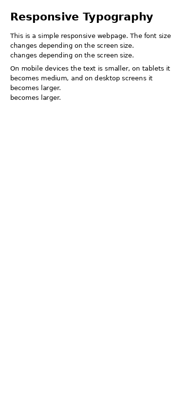

### Tablet
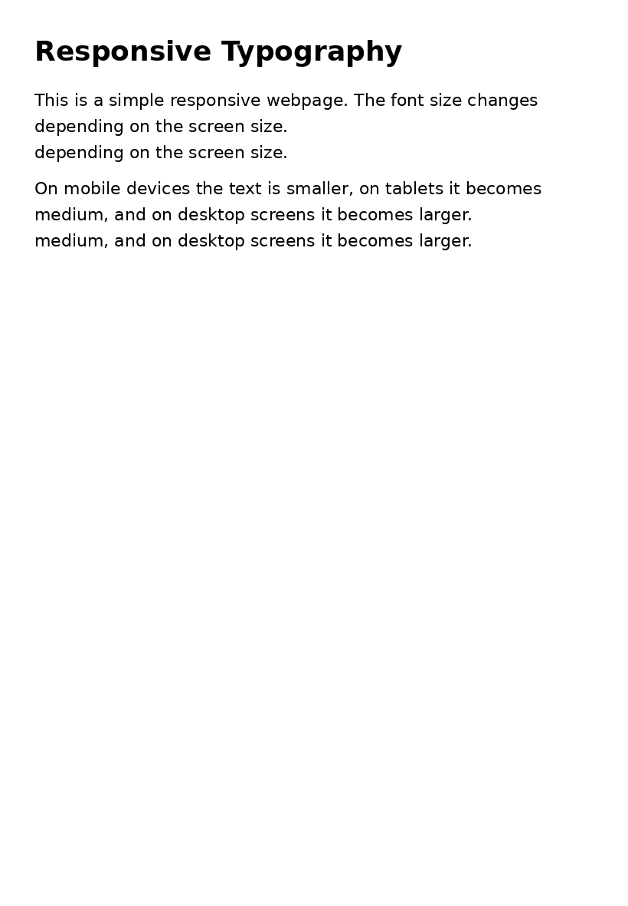

### Desktop
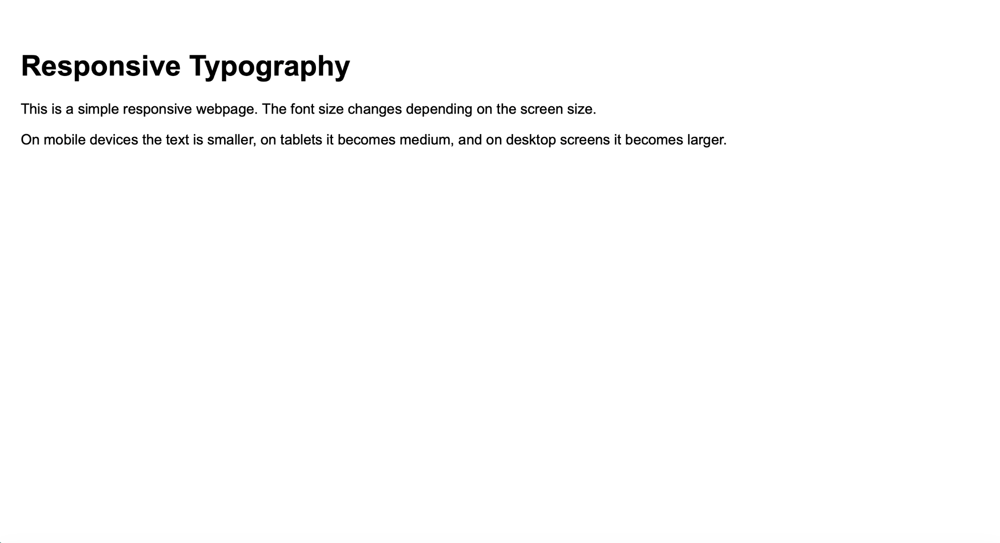

---

## Task 1 — Responsive Layout with Media Queries

Created three responsive boxes using only CSS Media Queries.

- Desktop: three boxes in one row.
- Tablet: two boxes in the first row and one box in the second row.
- Mobile: all boxes are stacked vertically.

### Mobile
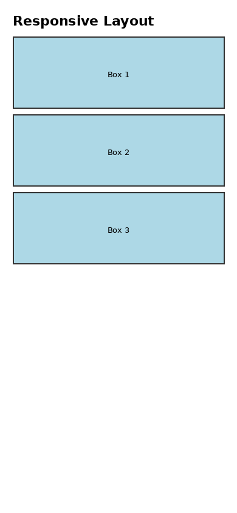

### Tablet
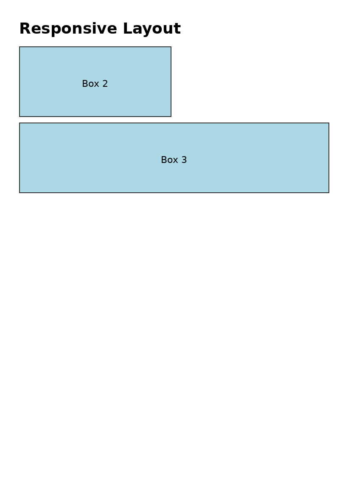

### Desktop
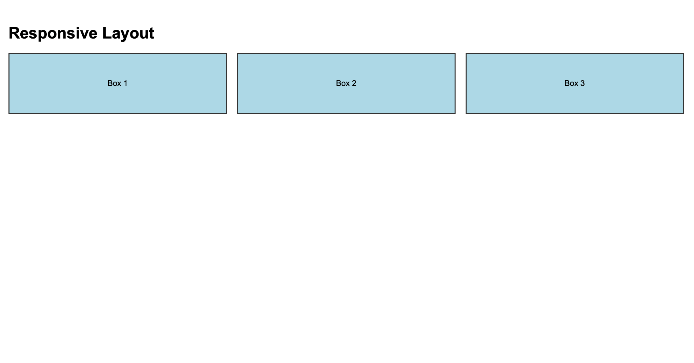

---

# Part 2. Bootstrap Grid System

## Task 2 — Bootstrap Responsive Columns

Created three responsive columns using Bootstrap's 12-column grid.

- Desktop: 4 + 4 + 4
- Tablet: 6 + 6
- Mobile: 12 + 12 + 12

### Mobile
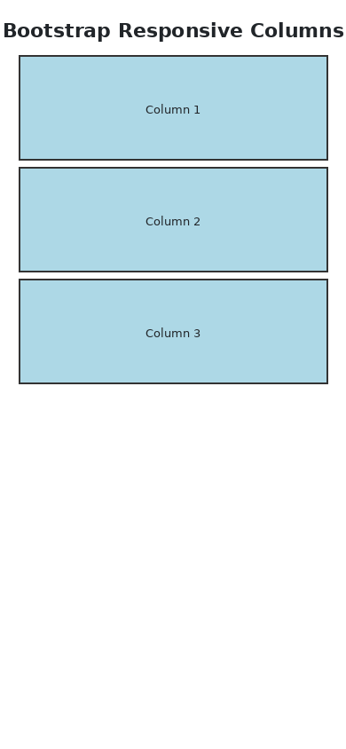

### Tablet
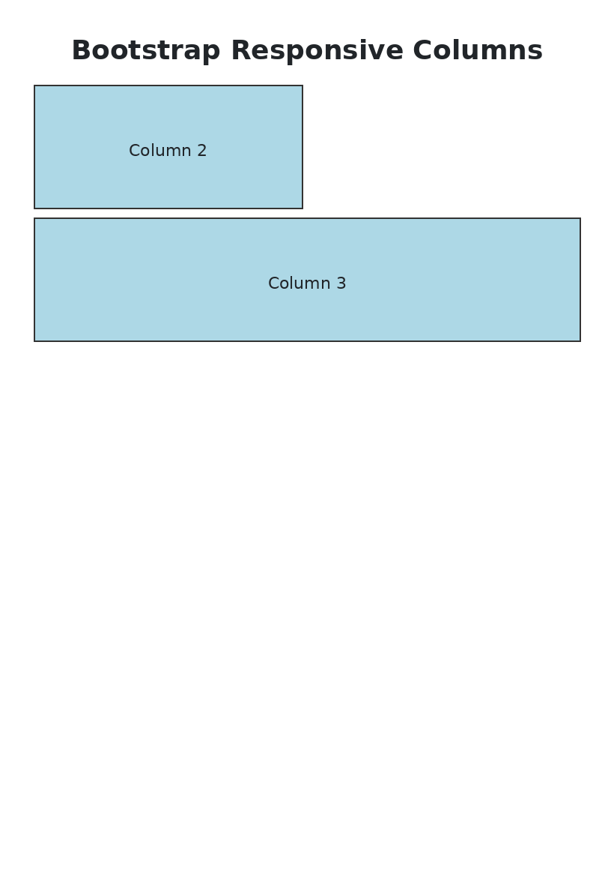

### Desktop
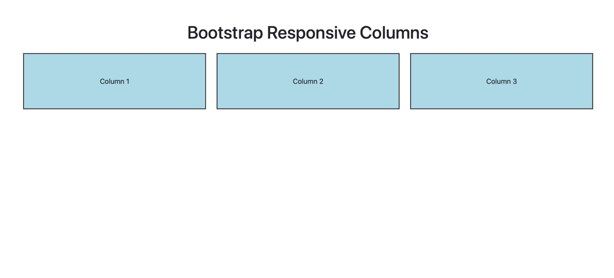

---

## Task 3 — Bootstrap Navigation Bar

Created a responsive Bootstrap navigation bar with:

- Logo
- Navigation links
- Hamburger menu on smaller screens

### Desktop
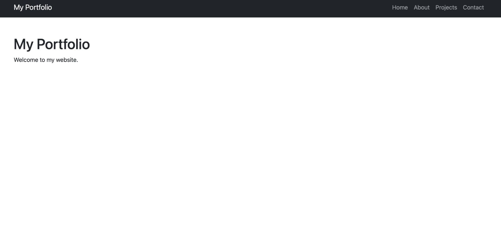

### Mobile
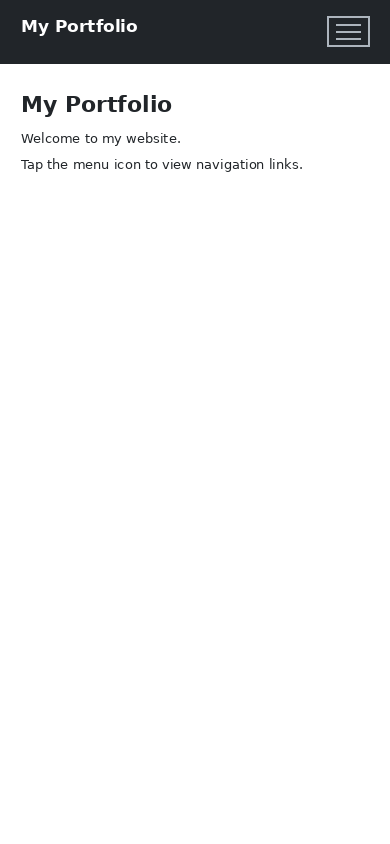

---

# Part 3. Combined Project

## Task 4 — Responsive Portfolio Page

Created a responsive portfolio page using Bootstrap Grid and CSS Media Queries.

The page includes:

- Responsive Bootstrap navigation bar
- Portfolio projects
- Personal information sidebar
- Contact details
- Responsive project cards
- Footer
- Custom Media Queries for different screen sizes

### Mobile
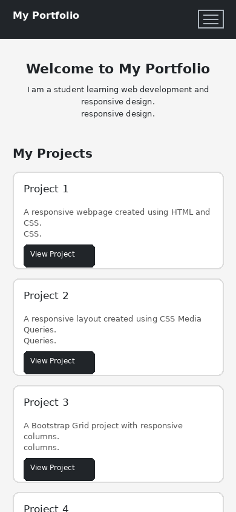

### Desktop
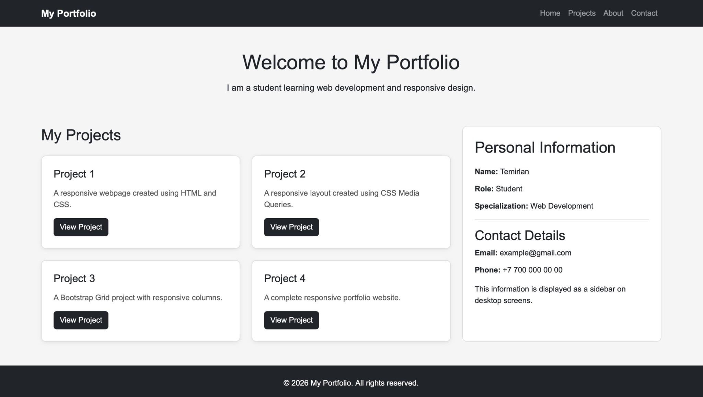

---

# Work Process

I created the project using HTML, CSS Media Queries, and Bootstrap.
I tested the pages on mobile, tablet, and desktop screen sizes.
The final portfolio combines Bootstrap Grid, responsive navigation,
and custom Media Queries.

---

# Technologies Used

- HTML5
- CSS3
- CSS Media Queries
- Bootstrap 5
- Responsive Web Design